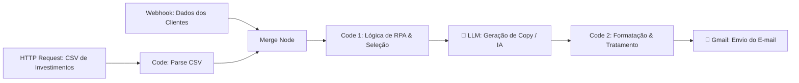

# 🤖 RPA de Recomendação de Investimentos com n8n, Python e LLM

Projeto prático desenvolvido para o curso **"Criando um Processo de RPA com N8N e Python"** na [DIO (Digital Innovation One)](https://dio.me).

O objetivo deste projeto é automatizar um processo completo de **RPA (Robotic Process Automation)** e **Hyperautomation**, integrando ingestão de dados, regras de negócio financeiras, inteligência artificial generativa (LLM) para redação de copy em conformidade regulatória e disparo de e-mails via Gmail.

---

## 🧭 Arquitetura e Fluxograma do Processo

  
    ⚙️ Detalhamento das Etapas do Fluxo
1. Ingestão de Dados (Webhook & HTTP Request)
Webhook: Ponto de entrada que recebe o payload com a lista de clientes, contendo dados cadastrais, e-mail, perfil de investidor e saldo em conta.
HTTP Request + Code (CSV): Faz o download de uma base pública/remota de produtos financeiros em formato CSV e converte em objetos JSON estruturados (perfil, produto, minimo, rentabilidade).
2. Unificação de Contexto (Merge)
Unifica as duas origens de dados em uma única carga de trabalho para que cada cliente possa ser cruzado com o catálogo de investimentos disponível.
3. Processamento e Regras de Negócio (Code 1)
Nó responsável pela inteligência algorítmica do RPA:

Conversão e Blindagem de Moeda: Normaliza formatos monetários (R$ 12.500,00 ➔ 12500).
Filtro de Adequação ao Perfil: Cruza o perfil do cliente (Conservador, Moderado, Arrojado) com os ativos correspondentes.
Validação de Saldo Mínimo: Garante que o cliente possui saldo suficiente para a aplicação mínima exigida.
Otimização de Rentabilidade: Identifica e seleciona a opção com a maior rentabilidade entre as alternativas viáveis.
4. Geração de Mensagem com IA (LLM Node)
Localizado estrategicamente entre o Code 1 e o Code 2:

Recebe os dados consolidados do cliente e o produto recomendado.
Gera uma mensagem hiperpersonalizada seguindo regras estritas de conformidade financeira:
Tom: amigável e profissional.
Formato: curto e direto (4 a 6 linhas).
Compliance: sem garantias de retorno e sem promessas de ganho futuro.
5. Sanitização e Estruturação (Code 2)
Recebe a resposta da LLM e normaliza todas as colunas para o envio (email_to, nome, saldo_texto, saldo_num, recomendacao, mensagem_base, copy_rules).
Trata eventuais inconsistências para garantir que nenhum e-mail seja disparado com campos vazios (empty).
6. Disparo Transacional (Gmail)
Envia um e-mail estruturado em HTML responsivo para o cliente, com aviso de riscos e detalhes da aplicação sugerida.
📁 Estrutura do Repositório
text

├── workflows/
│   └── rpa-investimentos-flow.json   # Export do workflow completo do n8n
├── scripts/
│   ├── code1_regras_negocio.js      # Código JavaScript do nó Code 1
│   ├── code2_formatacao_tabela.js   # Código JavaScript do nó Code 2
│   └── parse_csv.js                 # Código de conversão CSV ➔ JSON
└── README.md                        # Documentação do projeto
🚀 Como Executar este Projeto
Pré-requisitos
Uma instância ativa do n8n
 (Cloud ou Self-hosted via Docker).
Credencial configurada para a LLM (ex: OpenAI, Google Gemini ou Anthropic).
Conexão OAuth configurada no nó do Gmail.
Passo a passo
Clone este repositório:
bash

git clone https://github.com/SEU-USUARIO/SEU-REPOSITORIO.git
No painel do seu n8n, clique em Add Workflow ➔ Import from File... e selecione o arquivo do workflow.
Conecte suas credenciais nos nós da LLM e do Gmail.
Ative o workflow e execute o teste pelo Webhook.
👨‍💻 Autor
Projeto desenvolvido por Antonio Gabriel
Jornada de aprendizado em Inteligência Artificial e Automação na DIO
